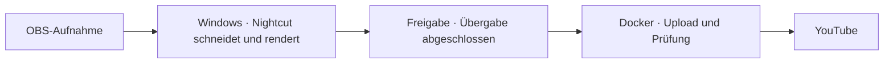

# VODWerft

**Aus langen OBS-Aufnahmen werden Folgen und Highlights. Windows schneidet, dein Docker-Server übernimmt den YouTube-Upload.**

[English](README.md) · [Auf die Warteliste](https://github.com/PaddyGameTV/VODWerft/issues/new?title=Warteliste%20%E2%80%94%20Windows%20%2B%20Docker&body=Windows-Version%3A%0AGrafikkarte%20und%20VRAM%3A%0ADocker-Host%20und%20Betriebssystem%3A%0ASpiel%20oder%20Aufnahmeart%3A)

> **0.1.0 · Lokaler Prototyp · Vorschau, noch nicht testbar.** Der Ablauf läuft auf einem Windows-PC mit Unraid-Server. Der weitergebbare Windows-Installer und das Docker-Paket sind in Arbeit und noch nicht veröffentlicht. Dieses Repository enthält derzeit nur die Dokumentation.

## So funktioniert der Ablauf

Der Windows-PC bearbeitet das Material. Sobald die Übergabe abgeschlossen ist, kann der Server selbstständig weiterarbeiten. Der Gaming-PC kann dann aus.

### Läuft bereits im Prototyp 0.1.0

- Ordnerüberwachung und Status im Windows-Tray. Profile für Folgen und ganze Missionen.
- YouTube-Uploads vom Server mit Thumbnails und geplantem Veröffentlichungstermin.
- Optionale Bereinigung, sobald YouTube alle Folgen eines Auftrags bestätigt hat.

| Baustein | Geplant für die erste Beta |
| --- | --- |
| **Windows-App** | Installer, Tray-Symbol, Auftragsfortschritt und geführter Testexport |
| **Aufnahmeprofile** | Eigene Ordner, Tonspuren und Schnittregeln. Lange Sessions in Folgen teilen oder eine ganze Mission als Video behalten. |
| **Docker-Dienst** | Dauerhafte Upload-Warteschlange, private Testuploads, Thumbnails und Prüfung. Geplante Veröffentlichungen hängen von der YouTube-Einrichtung ab. |
| **Bedienung** | Neue Aufträge pausieren, Fehler ansehen und eine Bereinigung nach erfolgreicher Prüfung bei Bedarf einschalten |

## Voraussetzungen

Das wird für die erste Beta voraussichtlich gebraucht:

- Ein Windows-PC mit NVIDIA-Grafikkarte und 16 GB VRAM. Das ist die Vorgabe von Nightcut. Nightcut selbst läuft auch unter Linux und auf Apple-Silicon-Macs, die VODWerft-App (Installer und Tray) ist vorerst nur für Windows geplant.
- [ffmpeg](https://ffmpeg.org/), im PATH erreichbar.
- [Ollama](https://ollama.com/) für das lokale Sprachmodell.
- [uv](https://docs.astral.sh/uv/). Es installiert Python und alle Pakete automatisch.
- Ein Docker-Host im selben Netz, zum Beispiel Unraid oder Linux.
- Ein eigenes YouTube-API-Projekt mit OAuth-Zugang für den Upload. Diese Einrichtung ist der aufwendigste Teil und wird in der Beta gemeinsam dokumentiert.
- OBS mit getrennten Tonspuren für die Aufnahme.

## Warteliste für die erste Beta

Noch gibt es nichts zum Installieren. Für die erste kleine Gruppe sammeln wir schon jetzt Interessierte, damit wir später gezielt Leute einladen können. Gesucht sind Leute mit einem Windows-PC, einer NVIDIA-GPU und einem Docker-Host wie Unraid oder Linux. Besonders willkommen sind **Spiele und Aufnahmen jenseits von Space Engineers und Arma 3**, den beiden Profilen aus dem Prototyp.

Der erste Test ist überschaubar. Verarbeite eine kurze Aufnahme, bestätige die Übergabe im Tray und schalte den Windows-PC aus. Dann prüfe, ob dein Server den privaten Testupload beendet. Uns interessiert, wo die Einrichtung hakt und wie sich der Ablauf bei Verbindungsabbrüchen oder Neustarts verhält.

[**Auf die Warteliste setzen**](https://github.com/PaddyGameTV/VODWerft/issues/new?title=Warteliste%20%E2%80%94%20Windows%20%2B%20Docker&body=Windows-Version%3A%0AGrafikkarte%20und%20VRAM%3A%0ADocker-Host%20und%20Betriebssystem%3A%0ASpiel%20oder%20Aufnahmeart%3A) und beschreib kurz dein Setup. Issues sind öffentlich. Teile dort nur Angaben zu deiner Hard- und Software, keine Zugangsdaten, Tokens oder Pfade.

## Mitwirkende

- **PaddyGameTV** · Projektgründer und Maintainer
- **OpenAI Codex** · KI-Entwicklungsassistenz für Planung, Umsetzung und Dokumentation
- **Claude (Anthropic)** · KI-Entwicklungsassistenz für Umsetzung, Wartung und Dokumentation
- **Nilson89 (Nilson1489)** · Entwickler von [Nightcut](https://github.com/Nilson89/nightcut), der Grundlage für Analyse und Schnitt

VODWerft ist ein unabhängiges Projekt auf Basis von Nightcut. Nightcut übernimmt die lokale Videoanalyse und den Schnitt. VODWerft ergänzt Einrichtung, Ablaufsteuerung, Statusanzeige und Server-Upload. VODWerft steht unter der [MIT-Lizenz](LICENSE). Für den Nightcut-Code gelten zusätzlich die ursprüngliche MIT-Lizenz und der Copyright-Hinweis.
