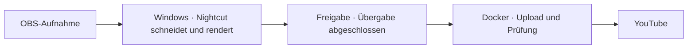

# VODWerft

**Aus langen OBS-Aufnahmen werden Folgen und Highlights. Windows schneidet, dein Docker-Server übernimmt den YouTube-Upload.**

[English](README.md) · [Als Tester melden](https://github.com/PaddyGameTV/VODWerft/issues/new?title=Beta-Test%20%E2%80%94%20Windows%20%2B%20Docker&body=Windows-Version%3A%0AGrafikkarte%20und%20VRAM%3A%0ADocker-Host%20und%20Betriebssystem%3A%0ASpiel%20oder%20Aufnahmeart%3A)

> **0.1.0 · Lokaler Prototyp · Tester gesucht.** Der Ablauf läuft auf einem Windows-PC mit Unraid-Server. Der weitergebbare Windows-Installer und das Docker-Paket sind in Arbeit.

## So funktioniert der Ablauf

Der Windows-PC bearbeitet das Material. Sobald die Übergabe abgeschlossen ist, kann der Server selbstständig weiterarbeiten. Der Gaming-PC kann dann aus.

### Läuft bereits im Prototyp 0.1.0

- Ordnerüberwachung und Status im Windows-Tray. Profile für Folgen und ganze Missionen.
- YouTube-Uploads vom Server mit Thumbnails und geplantem Veröffentlichungstermin.
- Optionale Bereinigung, sobald YouTube alle Folgen eines Auftrags bestätigt hat.
- Discord-Statusmeldungen in einem Thread pro Aufnahme.

| Baustein | Geplant für die erste Beta |
| --- | --- |
| **Windows-App** | Installer, Tray-Symbol, Auftragsfortschritt und geführter Testexport |
| **Aufnahmeprofile** | Eigene Ordner, Tonspuren und Schnittregeln. Lange Sessions in Folgen teilen oder eine ganze Mission als Video behalten. |
| **Docker-Dienst** | Dauerhafte Upload-Warteschlange, private Testuploads, Thumbnails und Prüfung. Geplante Veröffentlichungen hängen von der YouTube-Einrichtung ab. |
| **Bedienung** | Neue Aufträge pausieren, Fehler ansehen und eine Bereinigung nach erfolgreicher Prüfung bei Bedarf einschalten |

## Hilf uns, die Neuinstallation zu testen

Für die erste kleine Gruppe suchen wir Leute mit einem Windows-PC, einer NVIDIA-GPU und einem Docker-Host wie Unraid oder Linux. Besonders willkommen sind **Spiele und Aufnahmen jenseits von Space Engineers und Arma 3**, den beiden Profilen aus dem Prototyp.

Der erste Test ist überschaubar. Verarbeite eine kurze Aufnahme, bestätige die Übergabe im Tray und schalte den Windows-PC aus. Dann prüfe, ob dein Server den privaten Testupload beendet. Uns interessiert, wo die Einrichtung hakt und wie sich der Ablauf bei Verbindungsabbrüchen oder Neustarts verhält.

[**Tester-Issue öffnen**](https://github.com/PaddyGameTV/VODWerft/issues/new?title=Beta-Test%20%E2%80%94%20Windows%20%2B%20Docker&body=Windows-Version%3A%0AGrafikkarte%20und%20VRAM%3A%0ADocker-Host%20und%20Betriebssystem%3A%0ASpiel%20oder%20Aufnahmeart%3A) und beschreib kurz dein Setup. Issues sind öffentlich. Teile dort nur Angaben zu deiner Hard- und Software.

## Mitwirkende

- **PaddyGameTV** · Projektgründer und Maintainer
- **OpenAI Codex** · KI-Entwicklungsassistenz für Planung, Umsetzung und Dokumentation
- **Nilson89 (Nilson1489)** · Entwickler von [Nightcut](https://github.com/Nilson89/nightcut), der Grundlage für Analyse und Schnitt

VODWerft ist ein unabhängiges Projekt auf Basis von Nightcut. Nightcut übernimmt die lokale Videoanalyse und den Schnitt. VODWerft ergänzt Einrichtung, Ablaufsteuerung, Statusanzeige und Server-Upload. Für den Nightcut-Code gelten die ursprüngliche MIT-Lizenz und der Copyright-Hinweis.
