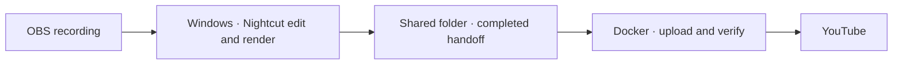

# VODWerft

**Turn long OBS recordings into episodes and highlights. Cut on Windows, hand off to your own server, and let Docker handle the YouTube upload.**

[Deutsch](README.de.md) · [Join the waitlist](https://github.com/PaddyGameTV/VODWerft/issues/new?title=Waitlist%20%E2%80%94%20Windows%20%2B%20Docker&body=Windows%20version%3A%0AGPU%20and%20VRAM%3A%0ADocker%20host%20and%20OS%3A%0AGame%20or%20recording%20type%3A)

> **0.1.0 · Local prototype · Preview, not testable yet.** The workflow is running on one Windows and Unraid setup. The distributable Windows installer and Docker package are in development and not released yet. This repository currently contains documentation only.

## How it works

The Windows machine does the media work. After the handoff finishes, the server can continue independently. VODWerft is built around that split, so a gaming PC does not have to stay on for the upload.

### Running in the 0.1.0 prototype

- Windows tray status and folder monitoring, with episode and full-mission profiles.
- Server-side YouTube uploads with thumbnails and scheduled publishing.
- Optional cleanup after every episode in a batch passes YouTube verification.
- Discord status threads for each recording.

| Component | First beta scope |
| --- | --- |
| **Windows app** | Installer, tray icon, job progress and a guided test export |
| **Recording profiles** | Configurable folders, audio tracks and editing modes. Split a long session into episodes or keep one mission as one video. |
| **Docker worker** | Persistent upload queue, private test uploads, thumbnails and verification. Scheduled publishing depends on the YouTube setup. |
| **Controls** | Pause new jobs, inspect errors and opt into cleanup only after successful verification |

## Requirements

What the first beta will most likely need:

- A Windows PC with an NVIDIA GPU and 16 GB of VRAM. This is Nightcut's own requirement. Nightcut itself also runs on Linux and Apple Silicon Macs, but the VODWerft app (installer and tray) is planned for Windows only for now.
- [ffmpeg](https://ffmpeg.org/), available on your PATH.
- [Ollama](https://ollama.com/) for the local language model.
- [uv](https://docs.astral.sh/uv/), which installs Python and all packages automatically.
- A Docker host on the same network, such as Unraid or Linux.
- Your own YouTube API project with OAuth access for uploads. This is the most involved part of the setup and will be documented together with the first testers.
- OBS with separate audio tracks for the recording.

## Waitlist for the first beta

There is nothing to install yet. We are collecting interested people now so we can invite a small first group later. We are looking for people with a Windows PC, an NVIDIA GPU and access to a Docker host such as Unraid or Linux. We especially want to try **games and recordings beyond Space Engineers and Arma 3**, which are the prototype's two profiles.

The first test is simple: process a short recording, confirm the handoff in the tray, shut down the Windows PC, and verify that the server finishes the private test upload. We'd like to hear where setup gets confusing and what happens when a connection drops or a machine restarts.

[**Join the waitlist**](https://github.com/PaddyGameTV/VODWerft/issues/new?title=Waitlist%20%E2%80%94%20Windows%20%2B%20Docker&body=Windows%20version%3A%0AGPU%20and%20VRAM%3A%0ADocker%20host%20and%20OS%3A%0AGame%20or%20recording%20type%3A) and tell us about your setup. Issues are public, so share hardware and software details only, never credentials, tokens or file paths.

## Credits

- **PaddyGameTV** · Project creator and maintainer
- **OpenAI Codex** · AI development assistance for planning, implementation and documentation
- **Claude (Anthropic)** · AI development assistance for implementation, maintenance and documentation
- **Nilson89 (Nilson1489)** · Creator of [Nightcut](https://github.com/Nilson89/nightcut), the upstream editing engine

VODWerft is an independent project built around Nightcut. Nightcut provides the local video analysis and editing. VODWerft adds setup, orchestration, status and server-side delivery. VODWerft is released under the [MIT License](LICENSE). The upstream MIT license and copyright notice additionally apply to Nightcut code.
