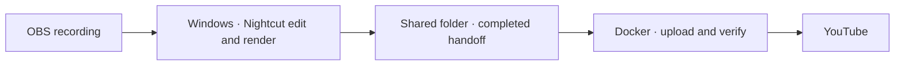

# VODWerft

**Turn long OBS recordings into episodes and highlights. Cut on Windows, hand off to your own server, and let Docker handle the YouTube upload.**

[Deutsch](README.de.md) · [Volunteer for testing](https://github.com/PaddyGameTV/VODWerft/issues/new?title=Early%20tester%20%E2%80%94%20Windows%20%2B%20Docker&body=Windows%20version%3A%0AGPU%20and%20VRAM%3A%0ADocker%20host%20and%20OS%3A%0AGame%20or%20recording%20type%3A)

> **0.1.0 · Local prototype · Looking for testers.** The workflow is running on one Windows and Unraid setup. The distributable Windows installer and Docker package are in development.

## How it works

The Windows machine does the media work. After the handoff finishes, the server can continue independently. VODWerft is built around that split, so a gaming PC does not have to stay on for the upload.

### Running in the 0.1.0 prototype

- Windows tray status and folder monitoring, with episode and full-mission profiles.
- Server-side YouTube uploads with thumbnails and scheduled publishing.
- Optional cleanup after every episode in a batch passes YouTube verification.
- Discord status threads for each recording.

| Component | First beta scope |
| --- | --- |
| **Windows app** | Installer, tray icon, job progress and a guided test export |
| **Recording profiles** | Configurable folders, audio tracks and editing modes. Split a long session into episodes or keep one mission as one video. |
| **Docker worker** | Persistent upload queue, private test uploads, thumbnails and verification. Scheduled publishing depends on the YouTube setup. |
| **Controls** | Pause new jobs, inspect errors and opt into cleanup only after successful verification |

## Help test a clean install

We're looking for a small first group with a Windows PC, an NVIDIA GPU and access to a Docker host such as Unraid or Linux. We especially want to try **games and recordings beyond Space Engineers and Arma 3**, which are the prototype's two profiles.

The first test is simple: process a short recording, confirm the handoff in the tray, shut down the Windows PC, and verify that the server finishes the private test upload. We'd like to hear where setup gets confusing and what happens when a connection drops or a machine restarts.

[**Open a tester issue**](https://github.com/PaddyGameTV/VODWerft/issues/new?title=Early%20tester%20%E2%80%94%20Windows%20%2B%20Docker&body=Windows%20version%3A%0AGPU%20and%20VRAM%3A%0ADocker%20host%20and%20OS%3A%0AGame%20or%20recording%20type%3A) and tell us about your setup. Issues are public, so share hardware and software details only.

## Credits

- **PaddyGameTV** · Project creator and maintainer
- **OpenAI Codex** · AI development assistance for planning, implementation and documentation
- **Nilson89 (Nilson1489)** · Creator of [Nightcut](https://github.com/Nilson89/nightcut), the upstream editing engine

VODWerft is an independent project built around Nightcut. Nightcut provides the local video analysis and editing. VODWerft adds setup, orchestration, status and server-side delivery. The upstream MIT license and copyright notice apply to Nightcut code.
